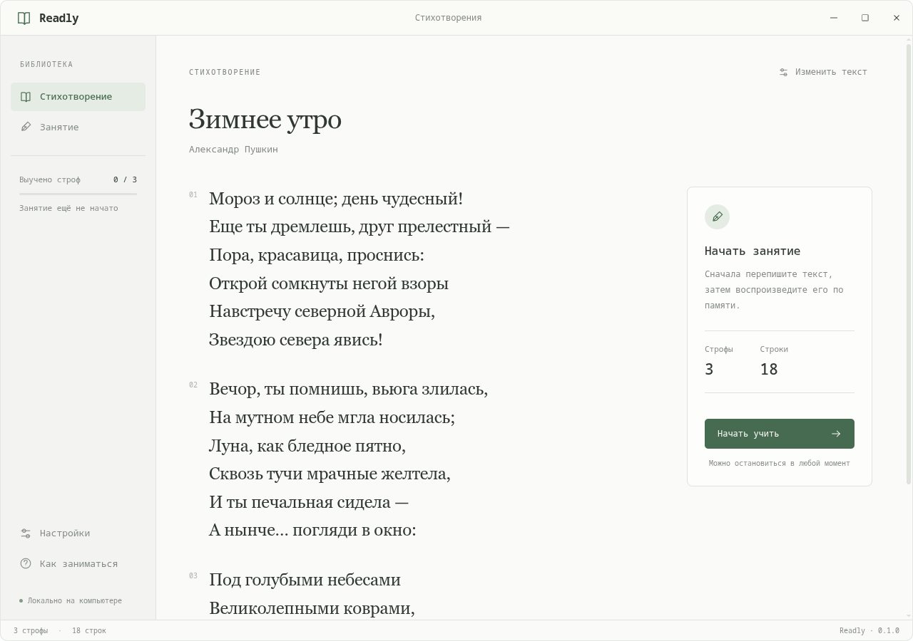

# Readly

Локальное приложение для заучивания стихов на **Rust + TypeScript + Electron**. Спокойный интерфейс с книжным шрифтом, светлой, тёмной и сепия-темой. Стиль ориентирован на локальный проект Typoha; код приложения написан отдельно.



## Запуск

Нужны Node.js 22.12+ (или 24+), npm и стабильный Rust с Cargo. В Linux также нужны системные библиотеки Electron и работающая графическая сессия.

```sh
./run.sh
```

Скрипт установит npm-зависимости при первом запуске, соберёт приложение и откроет Readly. Его можно запускать из любого каталога.

Для разработки с автоматическим обновлением интерфейса: `npm ci`, затем `npm run dev`.

Собрать и запустить без сервера разработки:

```sh
npm run build
npm start
```

Переносимая папка для Linux текущей архитектуры:

```sh
npm run pack
./release/Readly-linux-x64/Readly
```

Папка содержит Electron, собранное Rust-ядро и интерфейс. Node.js и Rust на компьютере получателя не нужны. Сборку для другой ОС нужно выполнять на соответствующей системе; скрипт переносимой папки пока рассчитан на Linux. Электронный runtime сохраняет свои файлы лицензий в папке сборки.

## Занятие

В **Настройки → Стихотворение** вставьте текст. Строки разделяйте переносом, строфы — пустой строкой. На главной странице показан весь текст.

1. Каждая строка: переписать с образца, затем написать по памяти.
2. После строк: вся строфа с образца и по памяти.
3. После второй и каждой следующей строфы: предыдущая строфа с образца и по памяти, затем все выученные строфы вместе с образца и по памяти.
4. После последнего общего повторения занятие завершено.

Ошибочный ответ не продвигает занятие. Подсказка показывает образец, но требует повторить текущий шаг по памяти. Enter переносит строку, **Ctrl + Enter** (или Cmd + Enter) проверяет ответ. Проверка происходит по нажатию кнопки, без таймера. Прогресс сохраняется после каждого верного ответа; незаконченный ввод не сохраняется. Можно вернуться к тексту стихотворения и продолжить позже. Замена текста и повтор с начала требуют подтверждения, если есть прогресс.

В примере используется фрагмент «Зимнего утра» А. С. Пушкина, первые три строфы.

## Библиотека классики

Раздел **Классика** содержит 422 стихотворения восьми авторов: Пушкина, Лермонтова, Тютчева, Фета, Некрасова, Жуковского, Баратынского и Кольцова. Поиск работает по автору, названию и словам текста; регистр и различие ё/е не учитываются. Можно выбрать автора, просмотреть полный текст и нажать **Выбрать для занятия**. При замене текста с пройденными шагами приложение запрашивает подтверждение сброса прогресса. Выбранный текст сохраняется между запусками.

Каталог включён в сборку как JSON и не требует интернета, отдельного сервера или установки СУБД. Исходные строки и пустые строки между строфами сохранены. Использован раздел `klassika` из [PoetryCorpus Ильи Гусева](https://github.com/IlyaGusev/PoetryCorpus), снимок `7a5f70e6a46b4717f7c903671f9a6a917aee6162`. Оставлены только восемь перечисленных авторов, произведения от 4 до 120 непустых строк без явных цифровых сносок и примечаний со звёздочками; дубликаты исключены. Это автоматическая подборка, а не новая редакционная вычитка: варианты орфографии и пунктуации соответствуют исходному набору. Источник и исходное название доступны в просмотре каждого текста.

Лицензия репозитория источника — Apache License 2.0; её полный текст доступен в разделе «Об источнике библиотеки» и хранится в `src/data/PoetryCorpus-LICENSE.txt`. Каталог можно воспроизвести командой `python3 scripts/import-classics.py` (для повторного импорта нужен интернет; контрольная сумма источника проверяется). Для расширения достаточно обновить каталог, SQLite для такого объёма не требуется.

## Параметры

- Учёт регистра, пунктуации и различия ё/е включается независимо.
- По умолчанию сохраняется порядок строк; проверку переносов можно отключить.
- Точные пробелы: проверять отступы, повторные пробелы, пустые строки. Если отключено, лишние пробелы и пустые строки игнорируются.
- Светлая, тёмная, сепия или системная тема.
- Размер текста 18–34 px и непрозрачность фона 55–100%.

Прозрачным становится фон окна, текст сохраняет контрастность. Electron создаёт прозрачное окно; результат зависит от композитора и платформы. На некоторых Linux/Wayland-конфигурациях фон может оставаться непрозрачным. Изменения оформления показываются сразу; кнопка «Сохранить» записывает их, «Отменить» возвращает сохранённые параметры.

## Устройство

- `native/`: Rust-процесс, который разбирает строфы, строит последовательность заданий, нормализует ответы и записывает прогресс.
- `electron/`: изолированный preload и основной процесс Electron. Rust общается с Electron через JSON Lines в stdin/stdout; HTTP-сервера в готовом приложении нет.
- `src/`: интерфейс на TypeScript и CSS, без UI-фреймворка, внешних шрифтов и сетевых сервисов.
- `tests/`: интеграционные тесты ядра и сценарий настоящего приложения через Playwright Electron.

Данные лежат в `progress.json` в каталоге `app.getPath('userData')` (обычно `~/.config/readly-desktop/` в Linux). Запись через временный файл и атомарную замену. Если файл повреждён, приложение показывает ошибку и сохраняет файл без изменений. Для отдельного профиля можно задать переменную окружения `READLY_DATA_DIR`. Все данные локальны, телеметрии нет.

## Проверки

```sh
npm run build
npm test
cargo fmt --manifest-path native/Cargo.toml --check
cargo clippy --manifest-path native/Cargo.toml -- -D warnings
npm run test:ui
```

Для UI-теста требуется графическая сессия (или `xvfb-run -a npm run test:ui`). Тест использует временный профиль: проверяет ошибочные и верные ответы, подсказку, полный цикл из двух строф, сохранение темы и прогресса после перезапуска. Скриншоты сохраняются в `test-results/`.

## Логотип и иконки

Логотип «Раскрытая книга» из первого варианта Figma: цветной знак используется для окна и панели задач (`assets/icon.svg`, `assets/icon.png`), внутри приложения тот же SVG используется как монохромная маска и наследует цвет текста текущей темы. В переносимую сборку включены значок и ярлык `readly-desktop.desktop`. При запуске в Linux приложение регистрирует ярлык в пользовательском каталоге XDG, чтобы значок отображался и в Wayland.

Иконки интерфейса — [Lucide](https://lucide.dev/), SVG сохранены локально в `src/assets/icons/`; интернет и дополнительные runtime-зависимости не требуются. Источник, снимок и ISC-лицензия находятся рядом с файлами иконок; лицензия также включается в переносимую сборку.
